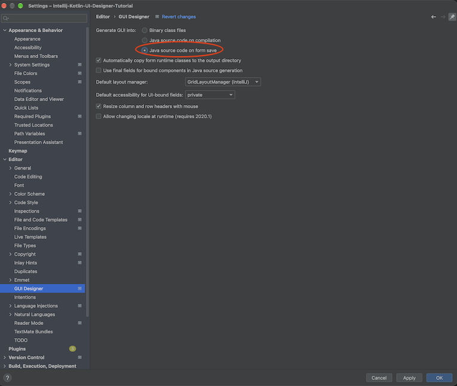
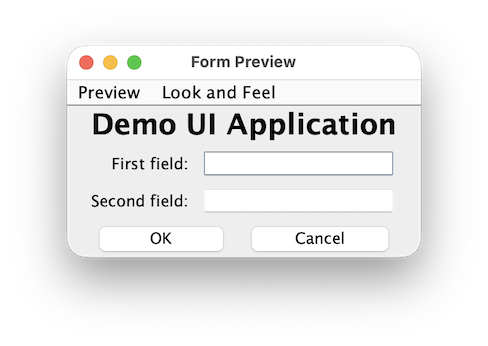
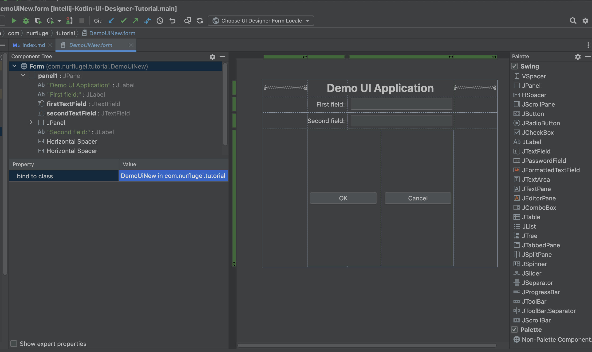

# Intellij-Kotlin-UI-Designer-Tutorial

## Overview
This is a tutorial on how to use JetBrains' Java-based UI designer in a Kotlin/Gradle dev environment.

The Java-based UI designer is a powerful tool that allows developers to create user interfaces for 
their applications without having to write any code. It provides a visual interface for 
designing layouts, adding components, and configuring their properties.

Normally, the JetBrains UI Designer only supports Java, and if you're a Kotlin fan like myself, that's limiting.  However,
the workaround is really pretty simple - since Gradle can host both Java and Kotlin in the same project, we let IDEA create the UI
in the Java source directory, and then create a Kotlin superclass in the Kotlin source directory.  Presto, chango - 
you're all set!

In this tutorial, we will walk you through the process of setting up the UI designer in a
Kotlin/Gradle development environment and creating a simple user interface.

OK, there's a little more to it than that, but we'll get to that in the tutorial.

## Why?  What's the point?
I write UI desktop apps, and I like using the Kotlin language.  I *also* like the JetBrains UI Designer - but it doesn't support Kotlin.
By using that to create my UI in Java, I can then inherit the Java UI classes in my Kotlin code.  This gives a really nice, 
clean separation of concerns between the UI and the business logic.  The 
Java code has all the visual layout, and the Kotlin code has all the business logic, without any of the UI cruft.

## Tutorial

### UI Designer Settings
First, we need to configure IDEA's UI designer to work with Kotlin/Gradle projects - here's the project setting (note that it's per *project*, not a global setting:



Note that rather than the default of having the UI designer inject code into the class files, 
we want it to explicitly "Generate Java in the source code on save".  That way any changes you make 
can be handled by the standard Gradle scripts without any need for Gradle to know about the UI designer code.

### Gradle

To add the dependencies for the UI Designer, we need to add the following dependency to our [`build.gradle.kts`](https://github.com/dbulla/Intellij-Kotlin-UI-Designer-Tutorial/blob/main/build.gradle.kts) file:

```kotlin
plugins {
    application
    kotlin("jvm") version "2.4.21"
}
dependencies {
    implementation("com.intellij:forms_rt:7.0.3")
}
```
The important line here is adding the dependency to the JetBrains **`forms_rt`** library.

Gradle already knows how to deal with mixed languages, so we don't need to do anything special to 
support Kotlin and Java in the same project - it just works!.

### The Code

#### The App
This is a super-simple UI - just a few components.  We want it to look like this:


##### What does our original code look like?
Before we dive into the UI designer code, what does it look like without it?  

In the src/main/kotlin directory, the file ["KotlinGridBagDemoUI"](https://github.com/dbulla/Intellij-Kotlin-UI-Designer-Tutorial/blob/main/src/main/kotlin/com/nurflugel/tutorial/KotlinGridBagDemoUI.kt) is the UI done with 
standard GridBagLayout - it's in Kotlin, but it's all boilerplate, and almost no important code other than the listeners.

<details markdown="1">
  <summary>📋 **Click this to expand the file contents**
<hr>
</summary>

  <!-- IMPORTANT: Leave an empty line above this comment -->

```kotlin
package com.nurflugel.tutorial

import java.awt.Dimension
import java.awt.Font
import java.awt.Font.BOLD
import java.awt.GridBagConstraints
import java.awt.GridBagConstraints.BOTH
import java.awt.GridBagConstraints.EAST
import java.awt.GridBagConstraints.HORIZONTAL
import java.awt.GridBagConstraints.VERTICAL
import java.awt.GridBagConstraints.WEST
import java.awt.GridBagLayout
import javax.swing.JButton
import javax.swing.JFrame
import javax.swing.JLabel
import javax.swing.JPanel
import javax.swing.JTextField
import javax.swing.SwingUtilities
import javax.swing.plaf.FontUIResource
import javax.swing.text.StyleContext

class KotlinGridBagDemoUI: JFrame() {
    private var demoLabel: JLabel
    private var firstTextField: JTextField
    private var secondTextField: JTextField
    private var okButton: JButton
    private var cancelButton: JButton

    companion object {
        @JvmStatic
        fun main(args: Array<String>) {
            SwingUtilities.invokeLater {
                val frame = KotlinDemoUIOOOOld()
                frame.pack()
                frame.isVisible = true
            }
        }
    }

    init {
        val mainPanel = JPanel()

        mainPanel.setLayout(GridBagLayout())
        demoLabel = JLabel()
        val demoLabelFont = createFont(null, BOLD, 28, demoLabel.getFont())
        if (demoLabelFont != null) demoLabel.setFont(demoLabelFont)
        demoLabel.setText("Demo UI Application")

        var gbc = GridBagConstraints()
        gbc.gridx = 1
        gbc.gridy = 0
        gbc.gridwidth = 3
        gbc.anchor = WEST
        mainPanel.add(demoLabel, gbc)
        val spacer1 = JPanel()
        gbc = GridBagConstraints()
        gbc.gridx = 4
        gbc.gridy = 0
        gbc.fill = HORIZONTAL
        mainPanel.add(spacer1, gbc)
        val spacer2 = JPanel()
        gbc = GridBagConstraints()
        gbc.gridx = 3
        gbc.gridy = 1
        gbc.fill = VERTICAL
        mainPanel.add(spacer2, gbc)
        firstTextField = JTextField()
        firstTextField.minimumSize = Dimension(100, 30)
        firstTextField.preferredSize = Dimension(100, 30)
        gbc = GridBagConstraints()
        gbc.gridx = 2
        gbc.gridy = 1
        gbc.anchor = WEST
        gbc.fill = HORIZONTAL
        mainPanel.add(firstTextField, gbc)
        val label1 = JLabel()
        label1.setText("Second field:")
        gbc = GridBagConstraints()
        gbc.gridx = 1
        gbc.gridy = 2
        gbc.anchor = EAST
        mainPanel.add(label1, gbc)
        secondTextField = JTextField()
        gbc = GridBagConstraints()
        gbc.gridx = 2
        gbc.gridy = 2
        gbc.anchor = EAST
        gbc.fill = HORIZONTAL
        mainPanel.add(secondTextField, gbc)
        val label2 = JLabel()
        label2.setText("First field:")
        gbc = GridBagConstraints()
        gbc.gridx = 1
        gbc.gridy = 1
        gbc.anchor = EAST
        mainPanel.add(label2, gbc)
        val panel2 = JPanel()
        panel2.setLayout(GridBagLayout())
        gbc = GridBagConstraints()
        gbc.gridx = 2
        gbc.gridy = 4
        gbc.fill = BOTH
        mainPanel.add(panel2, gbc)
        okButton = JButton()
        okButton.setText("OK")
        gbc = GridBagConstraints()
        gbc.gridx = 0
        gbc.gridy = 0
        gbc.fill = HORIZONTAL
        panel2.add(okButton, gbc)
        val spacer3 = JPanel()
        gbc = GridBagConstraints()
        gbc.gridx = 0
        gbc.gridy = 1
        gbc.fill = VERTICAL
        panel2.add(spacer3, gbc)
        cancelButton = JButton()
        cancelButton.setText("Cancel")
        gbc = GridBagConstraints()
        gbc.gridx = 1
        gbc.gridy = 0
        gbc.fill = HORIZONTAL
        panel2.add(cancelButton, gbc)
        val spacer4 = JPanel()
        gbc = GridBagConstraints()
        gbc.gridx = 2
        gbc.gridy = 3
        gbc.fill = VERTICAL
        mainPanel.add(spacer4, gbc)
        val spacer5 = JPanel()
        gbc = GridBagConstraints()
        gbc.gridx = 0
        gbc.gridy = 0
        gbc.fill = HORIZONTAL
        mainPanel.add(spacer5, gbc)

        contentPane = mainPanel
        defaultCloseOperation = EXIT_ON_CLOSE
    }

    @Suppress("SameParameterValue")
    private fun createFont(fontName: String?, style: Int, size: Int, currentFont: Font?): Font? {
        if (currentFont == null) return null
        val resultName: String = if (fontName == null) {
            currentFont.getName()
        }
        else {
            val testFont = Font(fontName, Font.PLAIN, 10)
            if (testFont.canDisplay('a') && testFont.canDisplay('1')) {
                fontName
            }
            else {
                currentFont.getName()
            }
        }
        val font = Font(resultName, if (style >= 0) style else currentFont.getStyle(), if (size >= 0) size else currentFont.getSize())
        val isMac = System.getProperty("os.name", "").lowercase().startsWith("mac")
        val fontWithFallback = if (isMac) Font(font.family, font.getStyle(), font.getSize()) else StyleContext().getFont(font.family, font.getStyle(), font.getSize())
        return fontWithFallback as? FontUIResource
                ?: FontUIResource(fontWithFallback)
    }
}

```

</details>

As you can see, GridBagLayout carries a *lot* of boilerplate!

##### The UI Designer

Now, I'll use the UI designer to create a form.  We're going to be using the Intellij's Grid Layout.  We right-click on the package, 
and select "New... SwingUI Form", then add the components to the form:



The form file for this is [DemoUiIntellijUiDesigner.form](https://github.com/dbulla/Intellij-Kotlin-UI-Designer-Tutorial/blob/main/src/main/java/com/nurflugel/tutorial/DemoUiIntellijUiDesigner.form) - 
we really don't care what's in there, as it's never meant to be modified by humans.  However, the Java file is - 
[DemoUiIntellijUiDesigner.java](https://github.com/dbulla/Intellij-Kotlin-UI-Designer-Tutorial/blob/main/src/main/java/com/nurflugel/tutorial/DemoUiNew.java).  Here's what that looks like:

<details markdown="1">

  <summary>📋 Click this to expand the file contents </summary>

```java
package com.nurflugel.tutorial;

import com.intellij.uiDesigner.core.GridConstraints;
import com.intellij.uiDesigner.core.GridLayoutManager;
import com.intellij.uiDesigner.core.Spacer;

import javax.swing.*;
import javax.swing.plaf.FontUIResource;
import javax.swing.text.StyleContext;
import java.awt.*;
import java.util.Locale;

public class DemoUiIntellijUiDesigner {
    protected JPanel panel1;
    protected JTextField firstTextField;
    protected JTextField secondTextField;
    protected JButton okButton;
    protected JButton cancelButton;

    {
// GUI initializer generated by IntelliJ IDEA GUI Designer
// >>> IMPORTANT!! <<<
// DO NOT EDIT OR ADD ANY CODE HERE!
        $$$setupUI$$$();
    }

    /**
     * Method generated by IntelliJ IDEA GUI Designer
     * >>> IMPORTANT!! <<<
     * DO NOT edit this method OR call it in your code!
     *
     * @noinspection ALL
     */
    private void $$$setupUI$$$() {
        panel1 = new JPanel();
        panel1.setLayout(new GridLayoutManager(4, 4, new Insets(0, 0, 0, 0), -1, -1));
        final JLabel label1 = new JLabel();
        Font label1Font = this.$$$getFont$$$(null, Font.BOLD, 24, label1.getFont());
        if (label1Font != null) label1.setFont(label1Font);
        label1.setText("Demo UI Application");
        panel1.add(label1, new GridConstraints(0, 1, 1, 2, GridConstraints.ANCHOR_CENTER, GridConstraints.FILL_NONE, GridConstraints.SIZEPOLICY_FIXED, GridConstraints.SIZEPOLICY_FIXED, null, null, null, 0, false));
        final JLabel label2 = new JLabel();
        label2.setText("First field:");
        panel1.add(label2, new GridConstraints(1, 1, 1, 1, GridConstraints.ANCHOR_EAST, GridConstraints.FILL_NONE, GridConstraints.SIZEPOLICY_FIXED, GridConstraints.SIZEPOLICY_FIXED, null, null, null, 0, false));
        firstTextField = new JTextField();
        panel1.add(firstTextField, new GridConstraints(1, 2, 1, 1, GridConstraints.ANCHOR_WEST, GridConstraints.FILL_HORIZONTAL, GridConstraints.SIZEPOLICY_WANT_GROW, GridConstraints.SIZEPOLICY_FIXED, null, new Dimension(150, -1), null, 0, false));
        secondTextField = new JTextField();
        panel1.add(secondTextField, new GridConstraints(2, 2, 1, 1, GridConstraints.ANCHOR_WEST, GridConstraints.FILL_HORIZONTAL, GridConstraints.SIZEPOLICY_WANT_GROW, GridConstraints.SIZEPOLICY_FIXED, null, new Dimension(150, -1), null, 0, false));
        final JPanel panel2 = new JPanel();
        panel2.setLayout(new GridLayoutManager(1, 2, new Insets(0, 0, 0, 0), -1, -1));
        panel1.add(panel2, new GridConstraints(3, 1, 1, 2, GridConstraints.ANCHOR_CENTER, GridConstraints.FILL_BOTH, GridConstraints.SIZEPOLICY_CAN_SHRINK | GridConstraints.SIZEPOLICY_CAN_GROW, GridConstraints.SIZEPOLICY_CAN_SHRINK | GridConstraints.SIZEPOLICY_CAN_GROW, null, null, null, 0, false));
        okButton = new JButton();
        okButton.setText("OK");
        panel2.add(okButton, new GridConstraints(0, 0, 1, 1, GridConstraints.ANCHOR_CENTER, GridConstraints.FILL_HORIZONTAL, GridConstraints.SIZEPOLICY_CAN_SHRINK | GridConstraints.SIZEPOLICY_CAN_GROW, GridConstraints.SIZEPOLICY_FIXED, null, null, null, 0, false));
        cancelButton = new JButton();
        cancelButton.setText("Cancel");
        panel2.add(cancelButton, new GridConstraints(0, 1, 1, 1, GridConstraints.ANCHOR_CENTER, GridConstraints.FILL_HORIZONTAL, GridConstraints.SIZEPOLICY_CAN_SHRINK | GridConstraints.SIZEPOLICY_CAN_GROW, GridConstraints.SIZEPOLICY_FIXED, null, null, null, 0, false));
        final JLabel label3 = new JLabel();
        label3.setText("Second field:");
        panel1.add(label3, new GridConstraints(2, 1, 1, 1, GridConstraints.ANCHOR_EAST, GridConstraints.FILL_NONE, GridConstraints.SIZEPOLICY_FIXED, GridConstraints.SIZEPOLICY_FIXED, null, null, null, 0, false));
        final Spacer spacer1 = new Spacer();
        panel1.add(spacer1, new GridConstraints(0, 0, 1, 1, GridConstraints.ANCHOR_CENTER, GridConstraints.FILL_HORIZONTAL, GridConstraints.SIZEPOLICY_WANT_GROW, 1, new Dimension(20, -1), new Dimension(20, -1), null, 0, false));
        final Spacer spacer2 = new Spacer();
        panel1.add(spacer2, new GridConstraints(0, 3, 1, 1, GridConstraints.ANCHOR_CENTER, GridConstraints.FILL_HORIZONTAL, GridConstraints.SIZEPOLICY_WANT_GROW, 1, new Dimension(20, -1), new Dimension(20, -1), null, 0, false));
    }

    /**
     * @noinspection ALL
     */
    private Font $$$getFont$$$(String fontName, int style, int size, Font currentFont) {
        if (currentFont == null) return null;
        String resultName;
        if (fontName == null) {
            resultName = currentFont.getName();
        } else {
            Font testFont = new Font(fontName, Font.PLAIN, 10);
            if (testFont.canDisplay('a') && testFont.canDisplay('1')) {
                resultName = fontName;
            } else {
                resultName = currentFont.getName();
            }
        }
        Font font = new Font(resultName, style >= 0 ? style : currentFont.getStyle(), size >= 0 ? size : currentFont.getSize());
        boolean isMac = System.getProperty("os.name", "").toLowerCase(Locale.ENGLISH).startsWith("mac");
        Font fontWithFallback = isMac ? new Font(font.getFamily(), font.getStyle(), font.getSize()) : new StyleContext().getFont(font.getFamily(), font.getStyle(), font.getSize());
        return fontWithFallback instanceof FontUIResource ? fontWithFallback : new FontUIResource(fontWithFallback);
    }

    /**
     * @noinspection ALL
     */
    public JComponent $$$getRootComponent$$$() {
        return panel1;
    }

}
```

</details>

At first glance, this doesn't seem to be much of an improvement - but when all the generated code is collapsed so you only see the necessary code - 
it's just the fields!  All you really care about is this [DemoUiNew.java](https://github.com/dbulla/Intellij-Kotlin-UI-Designer-Tutorial/blob/main/src/main/java/com/nurflugel/tutorial/DemoUiNew.java):

```java
package com.nurflugel.tutorial;

public class DemoUiIntellijUiDesigner {
    protected JPanel panel1;
    protected JTextField firstTextField;
    protected JTextField secondTextField;
    protected JButton okButton;
    protected JButton cancelButton;
}
```

Note that the fields are all protected - since we'll be extending this class in Kotlin, they can't be private (which is the default).

#### The Kotlin code
Now that we've got the Java UI code all set up, here's the Kotlin code [KotlinDemoUiIntellijUiDesigner.kt](https://github.com/dbulla/Intellij-Kotlin-UI-Designer-Tutorial/blob/main/src/main/kotlin/com/nurflugel/tutorial/KotlinDemoUiIntellijUiDesigner.kt):
```kotlin
package com.nurflugel.tutorial

import javax.swing.JFrame
import javax.swing.SwingUtilities
import kotlin.system.exitProcess

class KotlinDemoUiIntellijUiDesigner : DemoUiIntellijUiDesigner() {
    private var frame: JFrame = JFrame()

    init {
        addListeners()
        frame.contentPane = panel1
        frame.pack()
        frame.isVisible = true
    }

    private fun addListeners() {
        okButton.addActionListener { println("Doing something on OK pressed") }
        cancelButton.addActionListener { exitProcess(0) }
    }

    companion object {
        @JvmStatic
        fun main(args: Array<String>) {
            SwingUtilities.invokeLater {
                val frame = KotlinDemoUiIntellijUiDesigner()
            }
        }
    }

}
```

Look how simple that is, compared to the manual code!  All we need to do is import the generated Java class, add the listeners, 
wrap the generated form into a JFrame, and then display it.  

All of the layout, formatting, etc. is in the UI designer form, and you can concentrate on the business logic.